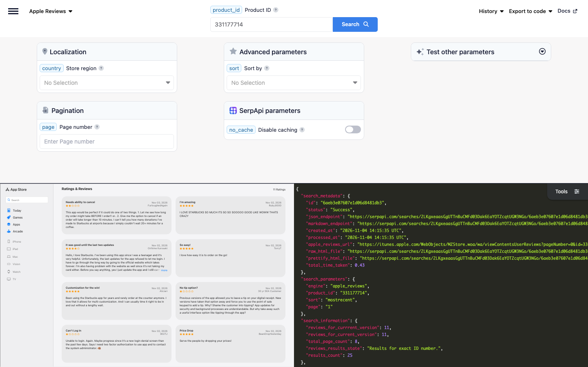

# Apple App Store Reviews Scraper

Scrape App Store reviews with SerpApi's Apple App Store Reviews API. Get the reviews of any iPhone, iPad, or Mac app with their title, text, rating, date, app version, and author, sorted by most recent, most helpful, most favorable, or most critical.

## How to scrape Apple App Store reviews

Get the reviews of an app with a simple GET request:

```text
https://serpapi.com/search?engine=apple_reviews&product_id=331177714&api_key=SERPAPI_API_KEY
```

- `product_id` is the App Store ID of the app, e.g., `331177714` for Starbucks. It's the number after `id` in the app's link, `https://apps.apple.com/us/app/starbucks/id331177714`, or the `id` of the app in the [Apple App Store API](https://serpapi.com/apple-app-store?utm_source=github_apple_app_store_reviews_scraper) results.
- `api_key` is your SerpApi API key. Replace `SERPAPI_API_KEY` with it.
- `sort` orders the reviews by `mostrecent` (default), `mosthelpful`, `mostfavorable`, or `mostcritical`.
- `country` sets the App Store region, e.g., `us` or `fr`.
- `page` gets the next pages of reviews. Each page has up to 25 reviews.

[Register at SerpApi](https://serpapi.com?utm_source=github_apple_app_store_reviews_scraper) to get your API key, and keep it private.

### Playground

Try the request live in the [SerpApi Playground](https://serpapi.com/playground?engine=apple_reviews&product_id=331177714&utm_source=github_apple_app_store_reviews_scraper).

[](https://serpapi.com/playground?engine=apple_reviews&product_id=331177714&utm_source=github_apple_app_store_reviews_scraper)

## Code examples

The code examples read your API key from the `SERPAPI_API_KEY` environment variable:

```bash
export SERPAPI_API_KEY="SERPAPI_API_KEY"
```

Each example gets the most recent reviews of the Starbucks app and prints the rating and title of each review on the first page.

### curl integration

Send the request with curl, which prints the full JSON response:

```bash
curl --get https://serpapi.com/search \
 --data-urlencode engine="apple_reviews" \
 --data-urlencode product_id="331177714" \
 --data-urlencode api_key="$SERPAPI_API_KEY"
```

### JavaScript integration

Install the [SerpApi JavaScript library](https://github.com/serpapi/serpapi-javascript) and set your project to use ES modules:

```bash
npm install serpapi
npm pkg set type=module
```

Create an `index.js` file:

```javascript
import { getJson } from "serpapi";

const results = await getJson({
  engine: "apple_reviews",
  api_key: process.env.SERPAPI_API_KEY,
  product_id: "331177714",
});

for (const review of results.reviews ?? []) {
  console.log(review.rating, review.title);
}
```

Run it with `node index.js`.

### Python integration

Install the [SerpApi Python library](https://github.com/serpapi/serpapi-python):

```bash
pip install serpapi
```

Create a `main.py` file:

```python
import os
import serpapi

client = serpapi.Client(api_key=os.getenv("SERPAPI_API_KEY"))
results = client.search({
    "engine": "apple_reviews",
    "product_id": "331177714",
})

for review in results.get("reviews", []):
    print(review["rating"], review["title"])
```

Run it with `python main.py`.

### Ruby integration

Install the [SerpApi Ruby library](https://github.com/serpapi/serpapi-ruby):

```bash
gem install serpapi
```

Create a `main.rb` file:

```ruby
require "serpapi"

client = SerpApi::Client.new(engine: "apple_reviews", api_key: ENV.fetch("SERPAPI_API_KEY"))
results = client.search(product_id: "331177714")

results.fetch(:reviews, []).each do |review|
  puts "#{review[:rating]} #{review[:title]}"
end

client.close
```

Run it with `ruby main.rb`.

### PHP integration

Install the [SerpApi PHP library](https://github.com/serpapi/serpapi-php):

```bash
composer require serpapi/serpapi-php
```

Create an `index.php` file:

```php
<?php
require 'vendor/autoload.php';

use SerpApi\Client;

$client = new Client(getenv('SERPAPI_API_KEY'), 'apple_reviews');
$results = $client->search([
  'product_id' => '331177714',
]);

foreach ($results->reviews ?? [] as $review) {
  echo $review->rating . ' ' . $review->title . PHP_EOL;
}
```

Run it with `php index.php`.

### Go integration

Create a Go module and install the [SerpApi Go library](https://github.com/serpapi/serpapi-golang):

```bash
go mod init example.com/reviews
go get github.com/serpapi/serpapi-golang
```

Create a `main.go` file:

```go
package main

import (
	"fmt"
	"os"

	"github.com/serpapi/serpapi-golang"
)

func main() {
	setting := serpapi.NewSerpApiClientSetting(os.Getenv("SERPAPI_API_KEY"))
	setting.Engine = "apple_reviews"
	client := serpapi.NewClient(setting)

	results, err := client.Search(map[string]string{
		"product_id": "331177714",
	})
	if err != nil {
		panic(err)
	}

	reviews, _ := results["reviews"].([]interface{})
	for _, item := range reviews {
		review := item.(map[string]interface{})
		fmt.Println(review["rating"], review["title"])
	}
}
```

Run it with `go run .`.

### Rust integration

Create a Cargo project and add the [SerpApi Rust library](https://github.com/serpapi/serpapi-rust) and Tokio:

```bash
cargo new reviews && cd reviews
cargo add serpapi tokio --features tokio/full
```

Replace `src/main.rs` with:

```rust
use serpapi::serpapi::Client;
use std::collections::HashMap;
use std::env;

#[tokio::main]
async fn main() -> Result<(), Box<dyn std::error::Error>> {
    let mut default = HashMap::new();
    default.insert("api_key".to_string(), env::var("SERPAPI_API_KEY")?);
    default.insert("engine".to_string(), "apple_reviews".to_string());
    let client = Client::new(default)?;

    let mut parameter = HashMap::new();
    parameter.insert("product_id".to_string(), "331177714".to_string());

    let results = client.search(parameter).await?;
    if let Some(reviews) = results["reviews"].as_array() {
        for review in reviews {
            println!(
                "{} {}",
                review["rating"],
                review["title"].as_str().unwrap_or_default()
            );
        }
    }
    Ok(())
}
```

Run it with `cargo run`.

### Other programming languages

Official libraries are also available for [Java](https://github.com/serpapi/serpapi-java), [.NET](https://github.com/serpapi/serpapi-dotnet), [Swift](https://github.com/serpapi/serpapi-swift), and [C++](https://github.com/serpapi/serpapi-cpp). See [SerpApi integrations](https://serpapi.com/integrations?utm_source=github_apple_app_store_reviews_scraper) for setup guides, or use a simple GET request from any programming language.

### Errors

Failed requests return an HTTP error status and a JSON body with an `error` message. The most common are `401` for an invalid API key, `400` for a missing required parameter such as `product_id`, and `429` when you exceed your hourly throughput limit or run out of searches. See [API status and error codes](https://serpapi.com/api-status-and-error-codes?utm_source=github_apple_app_store_reviews_scraper) for the full list.

## Output formats: JSON and Markdown

Choose structured JSON for applications or Markdown for LLMs and AI agents:

- JSON is the default output and is useful when you need individual result fields.
- Add `output=md` to receive Markdown instead, which is more token-efficient.

Markdown is plain text, not JSON: YAML front matter with the search metadata, followed by tables of the reviews. Read the response body as text instead of parsing it.

| Client | Markdown request |
|--------|------------------|
| curl | `--data-urlencode output="md"` |
| Python | `client.search({..., "output": "md"})` |
| PHP | `$client->md([...])` |
| Rust | `client.md(parameter).await?` |

If your SDK doesn't have a Markdown helper yet, send a plain HTTP request with `output=md` and read the body as text. Learn more about [Markdown output](https://serpapi.com/markdown-output?utm_source=github_apple_app_store_reviews_scraper).

## Apple App Store Reviews API parameters

See the [Apple App Store Reviews API documentation](https://serpapi.com/apple-reviews?utm_source=github_apple_app_store_reviews_scraper) for more details.

| Name | Description | Requirement |
|------|-------------|-------------|
| **Search query** | | |
| `product_id` | The App Store ID of the app (e.g., `331177714`). It's the number after `id` in the link of the app, or the `id` of the app in the Apple App Store API results. | Required |
| **Localization** | | |
| `country` | The App Store region, as a two-letter country code (e.g., `us`, `uk`, `fr`). Defaults to `us`. See [Apple regions](https://serpapi.com/apple-regions?utm_source=github_apple_app_store_reviews_scraper) for supported regions. | Optional |
| **Pagination** | | |
| `page` | The page of reviews (e.g., `1` for the first page, `2` for the second). Defaults to `1`. | Optional |
| **Advanced parameters** | | |
| `sort` | The order of the reviews: `mostrecent` (default), `mosthelpful`, `mostfavorable`, or `mostcritical`. It only applies to iPhone and iPad apps: Mac App Store reviews are always sorted by most recent. | Optional |
| **SerpApi parameters** | | |
| `engine` | Set to `apple_reviews`. | Required |
| `api_key` | Your private SerpApi API key. | Required |
| `no_cache` | Set to `true` to request fresh results instead of using the one-hour cache. Can't be combined with `async`. | Optional |
| `async` | Set to `true` for later retrieval through the [Searches Archive API](https://serpapi.com/search-archive-api?utm_source=github_apple_app_store_reviews_scraper). Can't be combined with `no_cache` or used with Ludicrous Speed enabled. | Optional |
| `zero_trace` | Enterprise only. Set to `true` to skip storing search parameters, files, and metadata on SerpApi servers. | Optional |
| `output` | Set to `json` (default), `html` for the raw HTML retrieved, or `md` for Markdown. | Optional |
| `json_restrictor` | Limit the JSON response to the fields you need. See the [JSON Restrictor](https://serpapi.com/json-restrictor?utm_source=github_apple_app_store_reviews_scraper) documentation. | Optional |

## Available data on Apple App Store reviews (JSON response)

Each item in `reviews` is a review of the app. The field guides below describe the possible fields and their types; they aren't literal API responses.

Each page has up to 25 reviews. To get the next page, increase `page` by 1 or follow `serpapi_pagination.next`. `search_information.total_page_count` tells you how many pages there are.

### Reviews

Each review in `reviews` can include these fields:

```json
{
  "reviews": [
    {
      "position": "Integer - Position of the review on the page",
      "id": "String - ID of the review",
      "title": "String - Title of the review",
      "text": "String - Text of the review",
      "rating": "Integer - Rating from 1 to 5",
      "review_date": "String - Date of the review, e.g., Nov 03, 2026",
      "reviewed_version": "String - Version of the app the review is for, e.g., Version 6.134.1",
      "author": {
        "name": "String - Username of the reviewer",
        "author_id": "String - ID of the reviewer"
      }
    }
  ]
}
```

### Search information and pagination

`search_information` describes the reviews, and `serpapi_pagination` links to the other pages:

```json
{
  "search_information": {
    "reviews_for_current_version": "Integer - Number of reviews, with or without text, for the current version of the app",
    "total_page_count": "Integer - Number of pages of reviews",
    "reviews_results_state": "String - Whether the results match the ID, e.g., Results for exact ID number.",
    "results_count": "Integer - Number of reviews on the page"
  },
  "serpapi_pagination": {
    "current": "String - SerpApi link to the current page",
    "next": "String - SerpApi link to the next page"
  }
}
```

## AI agents and no-code

### MCP

Give AI agents and assistants an App Store reviews tool with the hosted [SerpApi MCP server](https://github.com/serpapi/serpapi-mcp) at `https://mcp.serpapi.com/mcp`.

Claude Code:

```bash
claude mcp add --transport http serpapi https://mcp.serpapi.com/mcp --header "Authorization: Bearer $SERPAPI_API_KEY"
```

Codex, which reads the key from `SERPAPI_API_KEY`:

```bash
codex mcp add serpapi --url https://mcp.serpapi.com/mcp --bearer-token-env-var SERPAPI_API_KEY
```

Other MCP clients:

```json
{
  "mcpServers": {
    "serpapi": {
      "type": "http",
      "url": "https://mcp.serpapi.com/SERPAPI_API_KEY/mcp"
    }
  }
}
```

The server's engine catalog includes the `apple_reviews` engine, and its `serpapi://engines/apple_reviews` resource describes the parameters. Ask your agent to get the reviews of an app with the `apple_reviews` engine. The resulting tool call looks like this:

```json
{
  "name": "search",
  "arguments": {
    "params": {
      "engine": "apple_reviews",
      "product_id": "331177714"
    }
  }
}
```

See the [MCP integration guide](https://serpapi.com/integrations/mcp?utm_source=github_apple_app_store_reviews_scraper) for more clients and self-hosting.

### CLI

Get App Store reviews from your terminal or from AI agent workflows with the [SerpApi CLI](https://github.com/serpapi/serpapi-cli):

```bash
brew tap serpapi/homebrew-tap
brew install serpapi-cli
```

The CLI picks up `SERPAPI_API_KEY` from your environment. You can also run `serpapi login` to save a key.

```bash
serpapi search engine=apple_reviews product_id=331177714
serpapi search engine=apple_reviews product_id=331177714 --fields "reviews[].{rating, title, text}"
serpapi search engine=apple_reviews product_id=331177714 output=md
```

### No-code tools

Use SerpApi APIs without writing code:

- [NoCodeSerpApi](https://nocodeserpapi.com/)
- [SerpApi with n8n](https://serpapi.com/blog/tag/n8n/)
- [SerpApi with Make](https://serpapi.com/blog/tag/make/)
- [More integrations](https://github.com/serpapi/serpapi-integrations/)

## Use cases

- Monitor new reviews of your app, and catch bugs and complaints after each release.
- Analyze the sentiment and topics of reviews, overall or per app version.
- Compare what users like and dislike about competing apps.
- Collect the most critical reviews with `sort=mostcritical` to prioritize fixes.
- Compare reviews across App Store regions.
- Give AI agents and RAG pipelines the reviews to summarize.

## Related scrapers

- [Apple App Store Scraper](https://github.com/serpapi/apple-app-store-scraper): search apps and find their IDs
- [Apple App Store Product Scraper](https://github.com/serpapi/apple-app-store-product-scraper): the full product page of an app
- [Google Play Reviews Scraper](https://github.com/serpapi/google-play-reviews-scraper): reviews of Android apps on Google Play

## Resources

- [Scrape and Summarize App Reviews from the Apple App Store](https://serpapi.com/blog/scrape-and-summarize-app-reviews-from-the-apple-app-store/)
- [Scraping Apple App Store Product Info And Reviews with Python](https://serpapi.com/blog/scraping-apple-app-store-product-info-and-reviews-with-python/)
- [Web scraping Apple App Store Product Info And Reviews with Nodejs](https://serpapi.com/blog/web-scraping-apple-app-store-product-info-and-reviews-with-nodejs/)
- [Topic Analysis of App Store Reviews: A Heatmap Approach with the App Store Reviews Scraper API](https://serpapi.com/blog/topic-analysis-of-app-store-reviews-a-heatmap-approach-with-the-app-store-reviews-scraper-api/)

## Contact

Feel free to reach out at [contact@serpapi.com](mailto:contact@serpapi.com).
